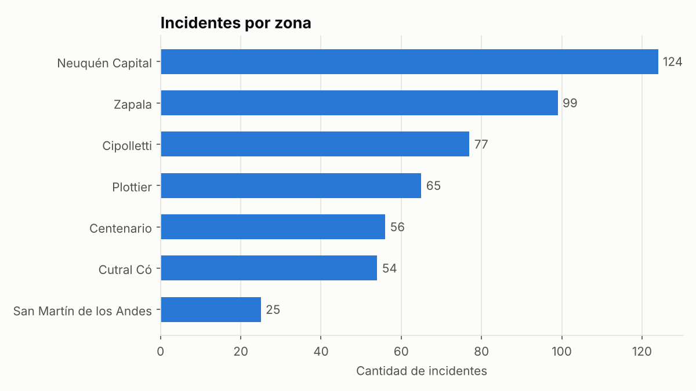
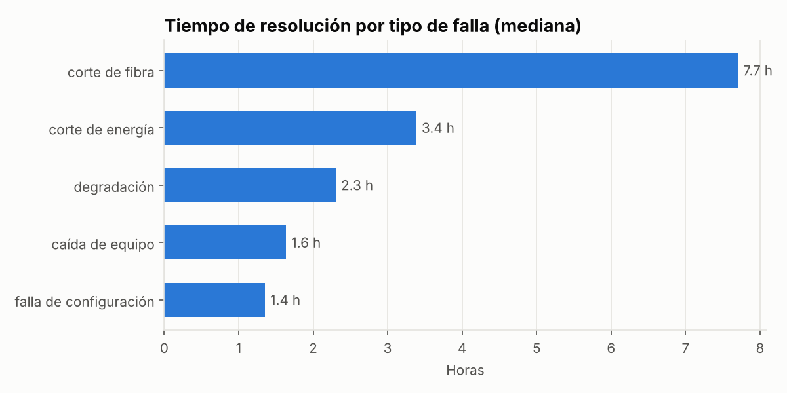
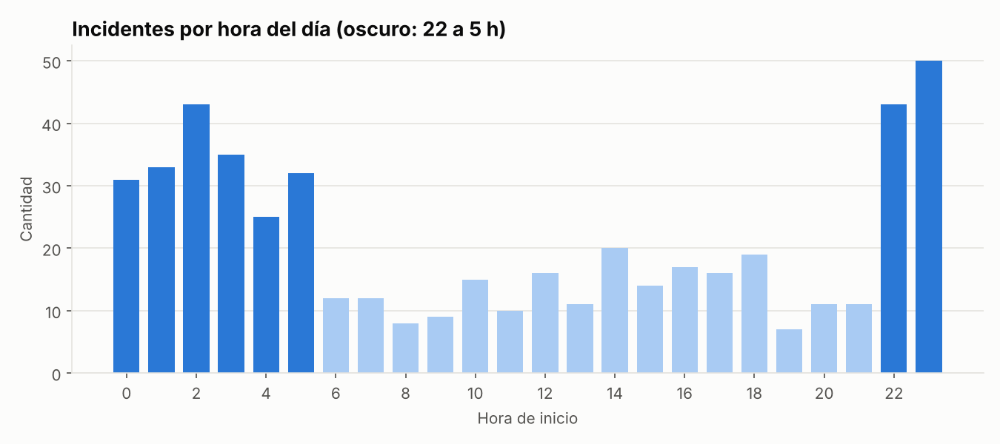
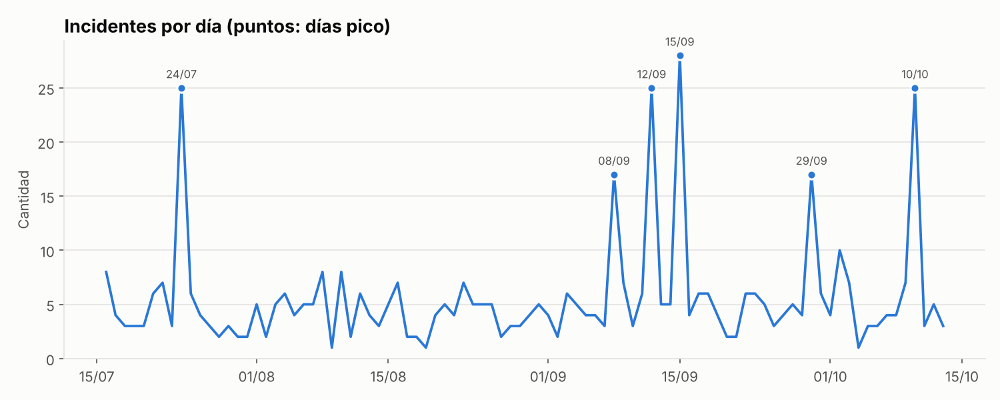

# Monitor de Incidentes

[](https://github.com/Guille143/monitor-incidentes/actions/workflows/tests.yml)

**[Ver el reporte diario en vivo](https://guille143.github.io/monitor-incidentes/)** · se genera solo todos los días con GitHub Actions.

API para registrar, consultar y analizar incidentes de red de un proveedor de telecomunicaciones, con clasificación y resúmenes generados por IA (Claude).

Proyecto de portfolio basado en mi experiencia como analista de redes y automatización. Los datos son ficticios y se generan con un script que reproduce patrones realistas (zonas con más fallas, cortes de fibra que tardan más en resolverse, picos nocturnos).

**Stack:** Python · FastAPI · SQLAlchemy · MariaDB · pandas · matplotlib · Claude API · Docker · pytest · GitHub Actions

## Resultados del análisis

Con los datos de prueba generados (500 incidentes en 90 días):






## Estado del proyecto

- [x] Etapa 1: API REST, base de datos MariaDB, Docker y generador de datos
- [x] Etapa 2: análisis de datos con pandas y gráficos
- [x] Etapa 3: clasificación y resumen de incidentes con IA
- [x] Etapa 4: reporte diario automático (GitHub Actions + GitHub Pages)

## Cómo correrlo

### Con Docker (recomendado)

```bash
cp .env.example .env          # y cambiá las contraseñas
docker compose up -d --build
docker compose exec api python -m scripts.generar_datos
```

La API queda en http://localhost:8000 y la documentación interactiva en http://localhost:8000/docs.

### Sin Docker (usa SQLite)

```bash
python -m venv .venv
source .venv/bin/activate      # en Windows: .venv\Scripts\activate
pip install -r requirements.txt
python -m scripts.generar_datos
uvicorn app.main:app --reload
```

### Análisis de datos

```bash
python -m scripts.analizar
```

Muestra los hallazgos principales y guarda gráficos y tablas en la carpeta `reportes/`:

- incidentes por zona
- tiempo de resolución por tipo de falla (mediana)
- incidentes por hora del día
- incidentes por día, con detección automática de días pico

### Funciones con IA

Necesitan una API key de Claude (se crea en [console.anthropic.com](https://console.anthropic.com)). Creá un archivo `.env` en la raíz del proyecto con esta línea:

```
ANTHROPIC_API_KEY=tu_key
```

El archivo `.env` está en el `.gitignore`, así que la key nunca se sube al repositorio.

- **`POST /ia/clasificar`**: recibe la descripción de un incidente en texto libre y devuelve tipo, severidad, causa probable y acción sugerida. La respuesta sale de una herramienta con esquema fijo, así que siempre tiene la misma estructura y se valida antes de usarla.
- **`POST /incidentes/desde-texto`**: lo mismo, pero además guarda el incidente con el tipo y la severidad que asignó la IA.
- **`GET /ia/resumen?dias=7`**: calcula las estadísticas del período con pandas y le pide a la IA un resumen ejecutivo con recomendaciones. La IA solo redacta: los números los calcula el código.

Por defecto usa Claude Haiku (rápido y barato). Se puede cambiar con la variable `CLAUDE_MODEL`.

### Reporte diario

```bash
python -m scripts.reporte_diario
```

Genera `reportes/reporte_AAAA-MM-DD.html`: indicadores de las últimas 24 horas comparados con el promedio de los 30 días anteriores, resumen escrito por IA, tabla de incidentes abiertos y gráficos. Es un único archivo HTML con los gráficos embebidos, listo para abrir o mandar por mail. Si no hay API key, se genera igual sin el resumen.

### Automatización

- **`.github/workflows/tests.yml`**: corre todos los tests en cada push.
- **`.github/workflows/reporte-diario.yml`**: todos los días a las 8:00 (Argentina) genera datos nuevos, arma el reporte y lo publica en GitHub Pages. La API key se guarda como secret del repositorio (`ANTHROPIC_API_KEY`).

### Tests

```bash
pytest
```

## Endpoints

| Método | Ruta | Qué hace |
| --- | --- | --- |
| GET | `/salud` | Chequeo de que la API está viva |
| GET | `/incidentes` | Lista con filtros: `zona`, `tipo`, `estado`, `severidad`, `limite` |
| GET | `/incidentes/{id}` | Un incidente |
| POST | `/incidentes` | Crea un incidente |
| PATCH | `/incidentes/{id}/resolver` | Lo marca como resuelto |
| GET | `/estadisticas/zonas` | Cantidad y tiempo promedio de resolución por zona |
| POST | `/ia/clasificar` | Clasifica un texto libre con IA |
| POST | `/incidentes/desde-texto` | Clasifica con IA y guarda el incidente |
| GET | `/ia/resumen` | Resumen ejecutivo de los últimos días, escrito por IA |

## Estructura

```
app/
  database.py    conexión a la base (MariaDB o SQLite según DATABASE_URL)
  models.py      tabla de incidentes
  schemas.py     validación de datos con Pydantic
  main.py        endpoints de la API
  analisis.py    funciones de análisis con pandas
  ia.py          clasificación y resúmenes con la API de Claude
  reporte.py     datos y HTML del reporte diario
scripts/
  generar_datos.py   carga incidentes ficticios
  analizar.py        genera gráficos y tablas
  reporte_diario.py  genera el reporte diario en HTML
tests/
  test_api.py        tests de los endpoints
  test_analisis.py   tests del análisis
  test_ia.py         tests de la IA, con un cliente falso (no gastan créditos)
  test_reporte.py    tests del reporte diario
.github/workflows/
  tests.yml          tests automáticos en cada push
  reporte-diario.yml reporte diario automático
```
